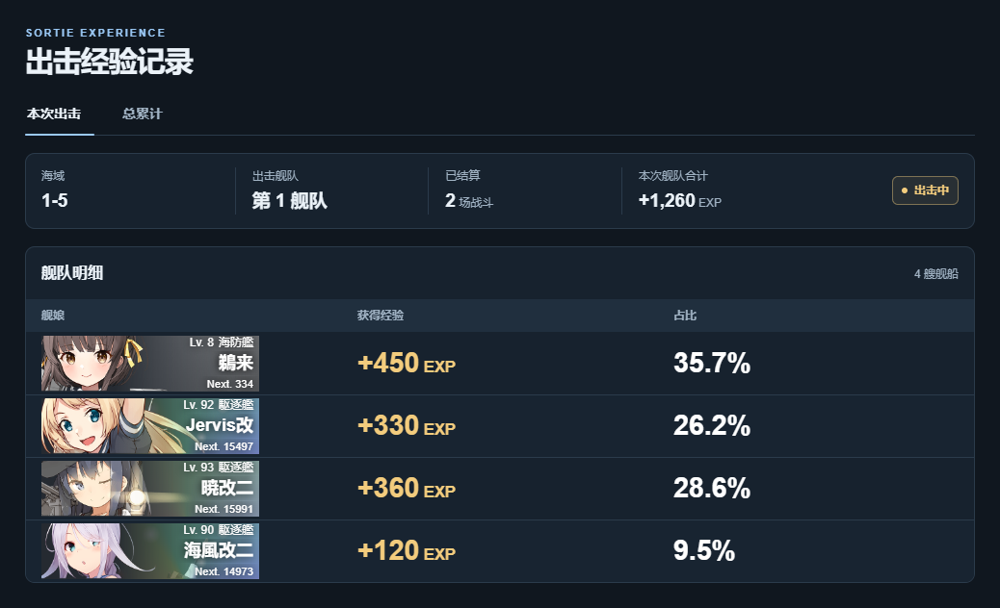
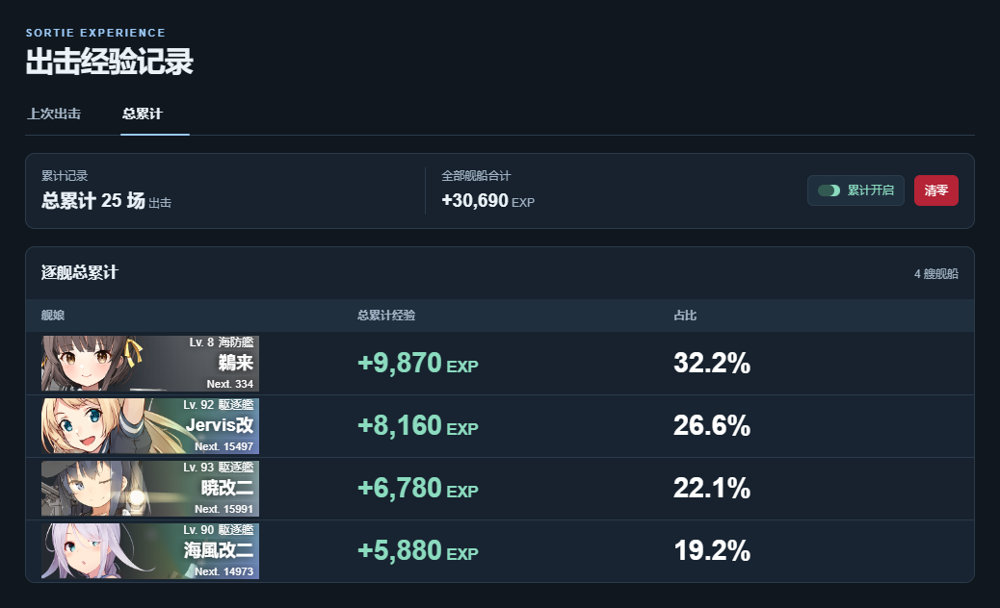

# 出击经验记录 · poi 插件

**出击经验记录**是从 Yahagi 首页的「出击经验」功能独立出来、为 poi 适配的插件。它用来查看每艘舰娘在普通出击和演习中获得了多少经验。[原项目 Yahagi](https://github.com/yamatosaki/yahagi-kancolle-browser)

普通出击每场战斗结算后，插件会更新逐舰经验、占比和舰队经验合计。返港后保留上一趟记录。演习结算也计为一次出击。

## 界面预览

**本次出击**显示海域、舰队、已结算场数和舰队经验合计。表格列出舰娘头像、等级、获得经验和占比。



**总累计**显示累计出击场数和全部舰船经验合计。表格列出每艘舰娘的累计经验和占比。



## 安装

在 poi 的「设置 → 插件」中找到「直接从 npm 服务器安装」，输入 `poi-plugin-sortie-exp` 并点击「安装」。安装后打开「出击经验记录」。也可以下载 `.tgz` 安装包，在同一页面从文件安装。[GitHub Releases](https://github.com/yamatosaki/poi-plugin-sortie-exp/releases) · [poi 插件安装入口](https://github.com/poooi/poi/blob/master/i18n/setting/zh-CN.json#L917-L923)

已在 Windows 上的 poi 12.0.1 验证。

## 使用说明

- **总累计默认关闭。** 开启后，插件统计开关开启期间结算的经验。普通出击在返港时入账，演习在结算时入账。
- **记录按账号保存在本机。** 换号后进入母港，插件会加载该账号的上一趟记录、总累计和累计开关。
- **清零只作用于当前账号。** 在弹窗中确认后，插件会清除总累计场数、逐舰累计经验，以及本趟尚未入账的经验。
- **逐舰经验上限为 9,999,999。** 刚好达到上限时保留，超过时该舰的对应经验归零，从下一场战斗重新累计。

## 本地开发

可将项目放到 poi 的 `plugins-extra/node_modules/poi-plugin-sortie-exp` 目录，重启 poi 后加载。

```powershell
npm test
npm pack --dry-run
npm pack
```

项目采用 [MIT 许可证](LICENSE)。
